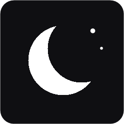
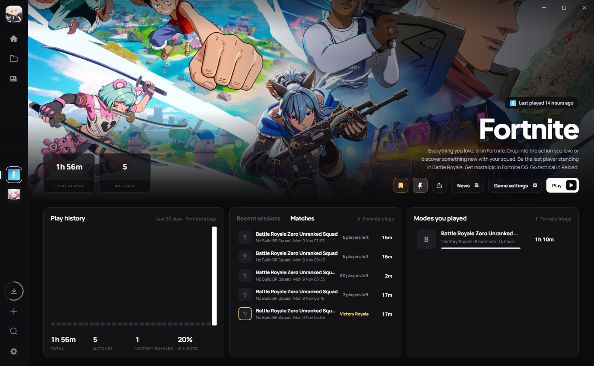
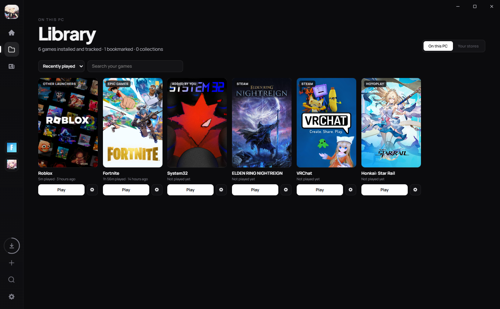
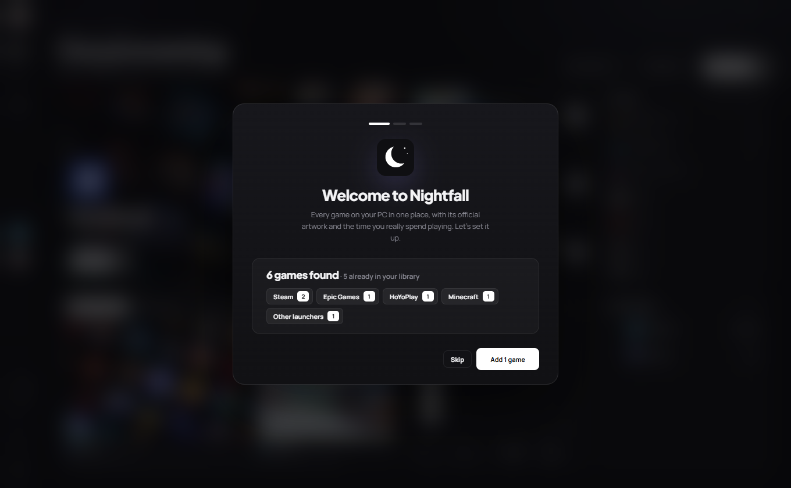
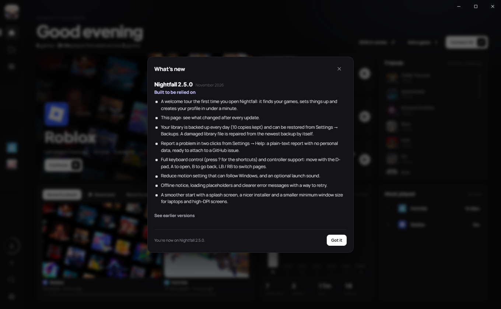
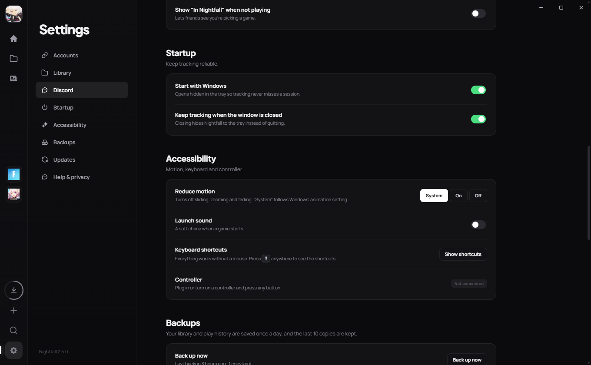

<p align="center">
  
</p>

<h1 align="center">Nightfall Launcher</h1>

<p align="center">
  <b>Every game you own, in one place.</b><br>
  A fast, private Windows game launcher that finds your games, gives them their official artwork and tracks how long you really play.
</p>

<p align="center">
  <a href="https://github.com/KYOO-DEVV/nightfall-launcher/releases/latest"><b>Download for Windows</b></a> ·
  <a href="https://kyoo-devv.github.io/nightfall-launcher/">Website</a> ·
  <a href="PRIVACY.md">Privacy</a> ·
  <a href="https://github.com/KYOO-DEVV/nightfall-launcher/issues/new">Report a problem</a>
</p>



## Features

- **Every launcher, one library.** Steam, Epic Games, GOG, Ubisoft Connect, Riot, HoYoPlay, EA, Rockstar, Xbox / Microsoft Store, Minecraft launchers, Amazon Games and itch.io are found automatically. Nothing to sign in to.
- **Real play time.** Tracked from running processes, even when you start a game from Steam or a desktop shortcut.
- **Match history.** Fortnite modes and Victory Royales, Valorant maps, agents and rounds, Roblox experiences and Minecraft instances, read from the games' own logs.
- **News** for the games you play: HoYoverse banners and version countdowns, Fortnite, Valorant, League of Legends and Steam announcements.
- **Your stores.** Open any game you own, even if it isn't installed, and watch installs fill its cover with colour.
- **Profile and sharing.** Picture, banner, bio, a showcase of your favourite games, Year in review and shareable stat cards.
- **Steam friends** and what they're playing, with no API key.
- **Discord** shows the game you're playing.
- **Works without a mouse.** Full keyboard shortcuts (press <kbd>?</kbd>) and controller support.
- **Dependable.** Daily backups, automatic repair of a damaged library, offline mode, signed automatic updates.

| | |
| --- | --- |
|  |  |
|  |  |

## Private by design

No account, no analytics, no tracking. Your library and play time are stored only on your PC. Nightfall goes online only to fetch public artwork, news, store details and updates. Read the full [privacy policy](PRIVACY.md).

## Install

1. Download `Nightfall-Launcher_x.y.z_x64-setup.exe` from the [latest release](https://github.com/KYOO-DEVV/nightfall-launcher/releases/latest).
2. Run it. Nightfall installs for your Windows user only, without admin rights.
3. The welcome tour finds your games and sets everything up in under a minute.

Nightfall updates itself. Installing over 1.x imports your library and play history.

> **SmartScreen:** the installer isn't code-signed yet, so Windows may show *"Windows protected your PC"* the first time. Click **More info → Run anyway**. Every update is still signed and verified by the app before it installs.

## FAQ

**Does Nightfall replace Steam or Epic?**
No. It launches games through their own launchers, so achievements, cloud saves and friends keep working.

**Is my play time accurate?**
Nightfall counts the time a game's process is running. Short blips under 30 seconds and sleep / hibernate gaps are left out.

**Where is my data?**
In `%APPDATA%\app.nightfall.launcher`. Backups are in the `backups` folder next to it, and can be restored from **Settings → Backups**.

**Something's wrong. What do I do?**
**Settings → Help → Create a report**, then [open an issue](https://github.com/KYOO-DEVV/nightfall-launcher/issues/new) and attach the file from your Downloads folder.

## Keyboard shortcuts

| Keys | Action |
| --- | --- |
| <kbd>Ctrl</kbd> <kbd>K</kbd> | Search your games |
| <kbd>Ctrl</kbd> <kbd>1</kbd>–<kbd>4</kbd> | Home, Library, News, Profile |
| <kbd>Ctrl</kbd> <kbd>,</kbd> | Settings |
| <kbd>Ctrl</kbd> <kbd>Enter</kbd> | Play the game on screen |
| <kbd>Alt</kbd> <kbd>←</kbd> | Back |
| Arrow keys / D-pad | Move between games and buttons |
| <kbd>?</kbd> | All shortcuts |

## Develop

Needs Rust, Node.js and the Visual Studio C++ Build Tools.

```bash
npm install
npm start          # tauri dev
npm run dist       # tauri build → src-tauri/target/release/bundle/nsis
```

- `src-tauri/src` — Rust backend: scanning, tracking, artwork, store libraries, game logs, Discord, friends, backups, updates
- `ui/` — the interface (plain HTML, CSS and JavaScript in WebView2)
- `docs/` — the website

Releases are signed for the updater with a private key kept outside the repository.
